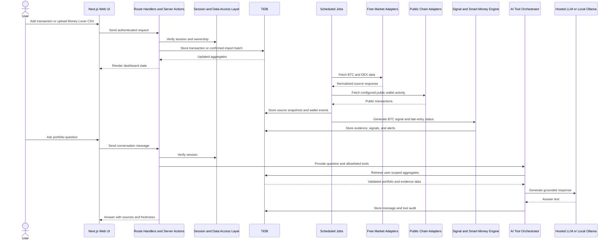
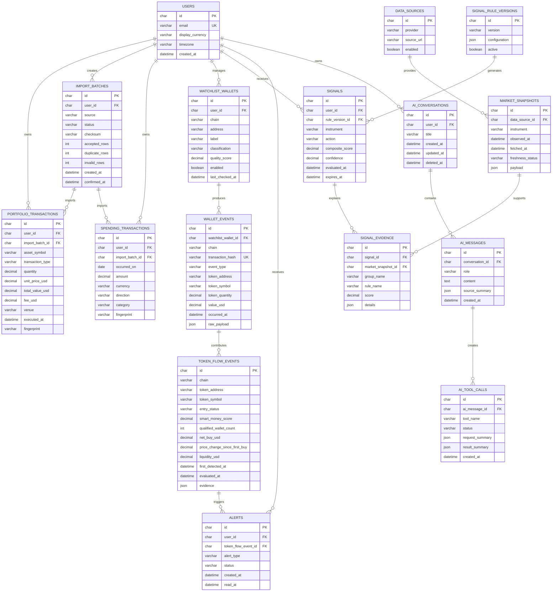

# Personal Finance & Bitcoin Research Terminal — PRD

## 1. Overview

### Product

A private personal-finance and crypto-research web application for one authenticated user. It tracks income, expenses, crypto transactions, portfolio performance, and public wallet activity; it also provides explainable daily BTC research signals and an AI assistant grounded in the user's own data.

The visual direction is inspired by [APIU](https://apiu.ai/): dark, dense, evidence-first research panels with visible data freshness, source receipts, confidence, and track record.

### MVP outcome

The user can:

- Record or import crypto buy, sell, transfer, reward, airdrop, and fee transactions.
- Upload a Money Lover CSV export and review monthly spending.
- View portfolio balances, allocation, average cost basis, realized P&L, and unrealized P&L.
- View a daily BTC/USD `BUY`, `SELL`, or `WATCH` research signal with evidence.
- Monitor qualified public wallets and inspect what they have bought or sold.
- Receive an in-app late-entry warning when a smart-money event is already extended or risky.
- Ask an AI assistant questions about portfolio, spending, BTC signals, smart-money activity, and data quality.

### Scope and budget decisions

- BTC/USD is the only signal-enabled instrument in MVP; portfolio tracking supports multiple crypto assets.
- Transactions are recorded manually at the actual executed price. The application does not execute trades, hold funds, or store exchange credentials.
- The MVP uses free or free-tier public data. Free data is a transparent approximation, not an equivalent replacement for licensed Arkham, Nansen, Bloomberg, or Dune intelligence.
- Do not scrape authenticated sites, bypass access controls, CAPTCHA, rate limits, or provider terms.

| Need | MVP data source |
|---|---|
| BTC price, market cap, historical data | CoinGecko Keyless Public API |
| Token pair, DEX liquidity, volume, price | DEX Screener public API |
| BTC public-address activity | mempool.space public API |
| EVM public-wallet activity | User-owned free Etherscan API key |
| Optional indexed DeFi data | User-owned The Graph free-plan key |
| Arkham, Nansen, Bloomberg, Dune | Deferred adapters, enabled only with valid licensed credentials |

CoinGecko's keyless API is intended for low-volume public use and has dynamic shared rate limits. [CoinGecko documentation](https://docs.coingecko.com/docs/keyless-public-api)

## 2. Requirements

### Functional requirements

| ID | Requirement | MVP acceptance criteria |
|---|---|---|
| FR-01 | Authentication | User can sign in, sign out, and access only their own records, alerts, and conversations. |
| FR-02 | Portfolio ledger | User can create, edit, delete, import, and export `BUY`, `SELL`, `TRANSFER_IN`, `TRANSFER_OUT`, `REWARD`, `AIRDROP`, and `FEE` transactions. |
| FR-03 | Market-price entry | A transaction form suggests market price for execution time; the user can override it with actual execution price and fee. |
| FR-04 | Portfolio analytics | System calculates balances, allocation, average cost basis, realized P&L, unrealized P&L, and incomplete-data warnings. |
| FR-05 | Money Lover import | User uploads CSV, maps columns, previews validation issues, deduplicates records, and confirms import. |
| FR-06 | Spending analysis | User can view income, expenses, savings rate, category totals, and month-over-month changes. |
| FR-07 | BTC research | User sees BTC market context, trend, volatility, latest signal, confidence, freshness, and signal history. |
| FR-08 | BTC signal engine | System generates a versioned, explainable daily `BUY`, `SELL`, or `WATCH` signal from persisted source snapshots. |
| FR-09 | Smart Money Watch | User can monitor public wallets and view observed token buys, sells, transfers, wallet qualification, and source transaction links. |
| FR-10 | Late-entry detector | System labels token events `EARLY`, `CONFIRMED`, `EXTENDED`, or `AVOID` and creates in-app warnings. |
| FR-11 | AI assistant | User can ask grounded questions about their own portfolio, spending, BTC research, smart-money events, and data gaps. |
| FR-12 | Audit trail | Imports, snapshots, signals, wallet events, alerts, and AI tool calls are timestamped and traceable. |

### Non-functional requirements

- English-only interface, assistant responses, validation messages, and documentation.
- Persist timestamps in UTC and store the user's selected display timezone.
- Use `DECIMAL` database columns for fiat values and token quantities; never persist financial values as JavaScript floats.
- Keep all provider calls, database access, and secrets server-side.
- Scope every query with authenticated `user_id`.
- Cache public market data for at least 15 minutes; show a visible stale-data indicator instead of concealing failure.
- Use exponential backoff and bounded retries after API errors or `429` rate limits.
- Restrict uploads to CSV files of 10 MB or less.
- Do not store exchange credentials, CoinGecko credentials, private keys, seed phrases, or wallet signatures.
- The product is research-only and must not claim accurate, guaranteed, or profitable investment results.

## 3. Core Features (MVP)

### 3.1 Dashboard, portfolio, and spending

Primary navigation: `Overview` · `Portfolio` · `Spending` · `BTC Research` · `Smart Money Watch` · `Ask Portfolio` · `Settings`.

The overview dashboard contains:

- Total tracked portfolio value and daily change.
- Asset-allocation chart.
- BTC quantity, cost basis, current value, and unrealized P&L.
- Current-month income, expenses, and savings rate.
- Latest BTC signal with confidence, freshness, and evidence link.
- Latest smart-money event with late-entry status.
- Data-quality warnings for stale market data or incomplete cost basis.

Portfolio calculation rules:

- `BUY` increases quantity and average cost basis.
- `SELL` reduces quantity and realizes P&L using average-cost basis.
- `TRANSFER_IN` and `TRANSFER_OUT` change quantity but do not create realized P&L.
- `FEE` is retained in the ledger and included in cost/proceeds when applicable.
- User-entered execution price takes precedence over suggested market price.

### 3.2 Money Lover CSV import

1. User uploads a CSV export.
2. System detects columns and opens a mapping step.
3. Required mappings are date, amount, and transaction direction.
4. Optional mappings are category, account, note, and currency.
5. System normalizes dates, debit/credit conventions, currencies, and categories.
6. System identifies duplicates with a user-scoped row fingerprint.
7. User reviews accepted, duplicate, and invalid rows.
8. Only confirmed rows are persisted.

### 3.3 BTC signal engine

| Group | Source | Weight | Example rules |
|---|---|---:|---|
| Price momentum | CoinGecko BTC daily price history | 30% | 7-day and 30-day return |
| Trend | Derived daily close data | 25% | 20-day and 50-day moving-average relationship |
| Mean reversion | Derived daily close data | 20% | 14-day RSI |
| Volatility risk | Derived daily close data | 15% | 30-day realized volatility and drawdown |
| Public-wallet context | Configured BTC public wallets | 10% | Large observed inflow/outflow context |

Signal rules:

- Generate one signal after the UTC daily candle closes.
- Normalize each group to a `0–100` score and persist raw snapshots before calculation.
- `BUY`: composite score `>= 70`, fresh source data, and no risk kill switch.
- `SELL`: composite score `<= 30`, fresh source data, and no risk kill switch.
- `WATCH`: all other cases, including conflicting, stale, missing, or insufficient data.
- Risk kill switch: return `WATCH` when required market data is older than 24 hours or volatility exceeds configured thresholds.
- Store rule version, input scores, source timestamps, confidence, expiry time, and evidence for every signal.

### 3.4 Smart Money Watch

Smart money is a transparent public-wallet proxy, not a verified institutional identity.

| Classification | Meaning |
|---|---|
| `USER_VERIFIED` | Public wallet manually added and trusted by the user. |
| `PUBLICLY_ATTRIBUTED` | Wallet linked to a manually reviewed public source. |
| `HIGH_PERFORMANCE_PROXY` | Wallet meets measurable on-chain performance criteria. |
| `UNVERIFIED_WHALE` | Large activity is observed, but profitability and identity are unknown. |
| `EXCLUDED` | Exchange, bridge, contract, mixer, or suspicious/service address. |

A wallet can be classified `HIGH_PERFORMANCE_PROXY` only when it has at least 20 reconstructed closed positions, positive realized historical performance, win rate of at least 55%, median holding period over 30 minutes, recent activity within 30 days, and no dominant exchange/transfer/wash-like behavior.

Create a smart-money buy event when either:

- Two or more qualified wallets have net-bought the same token within 24 hours; or
- One qualified wallet makes a buy above its configured historical-size threshold.

Each event must show token, chain, contract address, DEX pair, qualified-wallet count, net observed buy/sell value, first and latest transaction time, liquidity, volume, price movement, transaction links, and evidence.

### 3.5 Late-entry detector and alerts

| Status | Conditions | System action |
|---|---|---|
| `EARLY` | Recent qualified buying cluster, acceptable liquidity, price move below 15% since first detection | Create research alert. |
| `CONFIRMED` | Multiple qualified wallets buying; price move 15–35% | Show cautious confirmation. |
| `EXTENDED` | Price move above 35%, elevated RSI, or declining buy volume | Create late-entry-risk warning. |
| `AVOID` | Low liquidity, very new pair, concentration risk, sharp reversal, suspicious pattern, or weak source data | Create high-risk warning and suppress buy-style alert. |

Alerts are in-app only for MVP. Deduplicate alerts by token, chain, and alert type within a 24-hour cooldown window.

### 3.6 AI Portfolio Assistant

Supported questions include:

- “What is my total portfolio value today?”
- “Which asset has the highest unrealized P&L?”
- “Why is BTC currently WATCH?”
- “How did my expenses change compared with last month?”
- “Am I too concentrated in BTC?”
- “What are the latest smart-money buys?”
- “Is this token already too late to enter?”
- “What data should I fix before trusting my P&L?”

| Tool | Purpose |
|---|---|
| `getPortfolioSummary` | Balances, allocation, cost basis, P&L, and data-quality warnings. |
| `getAssetPerformance` | Asset-level transactions and return analysis. |
| `getTransactions` | Filtered transaction history. |
| `getSpendingSummary` | Income, expenses, category analysis, and monthly trends. |
| `getBtcSignalExplanation` | Current or historical signal, rule scores, evidence, and freshness. |
| `getSmartMoneyEvents` | Wallet activity, token flow, late-entry state, and risk factors. |
| `getDataQualityReport` | Missing prices, stale data, incomplete imports, and unclassified wallets. |

The assistant must use authenticated server-side tools for user-data questions. It does not query the database directly, calculate financial values in free text, or receive user identity from model-generated arguments. Every factual answer includes source, calculation period, and freshness. Investment-related answers must include “Research only — not investment advice.”

## 4. User Flow

### Portfolio and spending setup

1. User registers, accepts the research-only disclaimer, and sets timezone/display currency.
2. User records portfolio transactions at the actual executed price or imports a supported transaction CSV.
3. System calculates balances, cost basis, and P&L; incomplete records are flagged.
4. User uploads and confirms a Money Lover CSV import.
5. Dashboard shows financial, portfolio, and data-quality summaries.

### Daily BTC research

1. Scheduled job fetches BTC public market data.
2. System validates freshness and stores immutable source snapshots.
3. Signal engine runs the active versioned rule set.
4. User opens `BTC Research` and inspects action, confidence, factors, evidence, and track record.
5. User independently acts outside the app, then records the actual transaction in the ledger.

### Smart Money Watch

1. User adds public wallet addresses or enables a curated public-wallet list.
2. System validates chain/address format and assigns a provisional classification.
3. Scheduled jobs ingest permitted public activity and normalize token events.
4. System calculates wallet quality, flow clusters, and late-entry status.
5. User receives an in-app alert and opens the event evidence before independently deciding what to do.

### AI Assistant

1. User opens `Ask Portfolio` and sends a question.
2. System verifies the session and persists the user message.
3. The AI orchestrator selects an allowlisted server-side tool.
4. Tool retrieves validated, user-scoped calculations and evidence.
5. Assistant responds with answer, source badges, freshness, and caveats.
6. User can ask a follow-up or delete the conversation.

## 5. Architecture

| Layer | Implementation |
|---|---|
| Frontend | Next.js App Router, TypeScript, Tailwind CSS, shadcn/ui. |
| Backend | Server Components, Server Actions, authenticated Route Handlers, and server-only data-access layer. |
| Database | TiDB with a MySQL-compatible ORM such as Drizzle ORM. |
| Market adapters | CoinGecko, DEX Screener, mempool.space, Etherscan, optional The Graph. |
| Signal engine | Deterministic versioned rules with immutable snapshots. |
| Smart-money engine | Wallet classifier, event normalizer, flow aggregator, late-entry scorer, and alert deduplicator. |
| AI | Server-only tool calling with hosted-model or local Ollama adapter. |
| Jobs | Coolify cron invokes authenticated internal scheduled-job endpoints. |
| Testing | Vitest for unit/integration tests; Testsprite for end-to-end flows. |
| Documentation | Context7 is used during development for current framework/library documentation; it is not a runtime dependency. |

## 6. Database Schema

| Table | Purpose |
|---|---|
| `portfolio_transactions` | Multi-asset transaction ledger and cost-basis input. |
| `import_batches` | Auditable Money Lover and portfolio import sessions. |
| `spending_transactions` | Normalized income and expense records. |
| `market_snapshots` | Immutable source data used in signals and research. |
| `signals` / `signal_evidence` | Versioned BTC decisions and supporting evidence. |
| `watchlist_wallets` | User-managed public-wallet watchlist and qualification state. |
| `wallet_events` | Source-linked observed wallet activity. |
| `token_flow_events` | Aggregated smart-money proxy data and late-entry classification. |
| `alerts` | Deduplicated research and risk notifications. |
| `ai_conversations` / `ai_messages` / `ai_tool_calls` | Private chat history and AI-data-access audit trail. |

## 7. Design & Technical Constraints

### Design constraints

- Use a dark terminal design with compact evidence cards and monospace financial figures.
- Never rely on color alone: every positive, warning, and risk state needs a text label.
- Display source, timestamp, freshness, confidence, and rule version next to every signal and smart-money event.
- Clearly distinguish `Observed`, `Calculated`, `Inferred`, `Unverified`, and `Stale` data.
- Make `EXTENDED` and `AVOID` visually dominant before positive smart-money interpretations.
- Include “Research only — not investment advice” in BTC research, smart-money, and investment-related AI responses.

### Technical constraints

- Use documented public APIs only and respect their terms/rate limits. DEX Screener endpoint limits are documented publicly. [DEX Screener API reference](https://docs.dexscreener.com/api/reference)
- Etherscan requires a user-owned free key and can change/throttle free access; queue requests conservatively. [Etherscan rate limits](https://docs.etherscan.io/resources/rate-limits)
- The Graph is optional and requires a user-owned API key; usage must be metered against its free quota. [The Graph documentation](https://thegraph.com/docs/en/subgraphs/querying/introduction/)
- Keep Next.js provider clients, environment variables, and data-access functions server-only; Route Handlers must authenticate and authorize access before serving data.
- The model must never provide or alter `user_id`; server session identity is injected into every AI tool call.
- Apply rate limits to imports, AI messages, and provider calls.
- Use idempotency keys for daily signal and wallet-ingestion jobs.
- Coolify is free only when self-hosted infrastructure already exists; dependable compute, domains, and premium data are outside a zero-budget guarantee.

### Test requirements

- Unit tests: portfolio calculations, cost basis, CSV mapping, duplicate detection, signal rules, wallet scoring, late-entry states, and AI tool authorization.
- Integration tests: user isolation, provider rate limits, stale-data behavior, failed imports, and idempotent scheduled jobs.
- Testsprite end-to-end tests:
  - Add a portfolio buy and verify portfolio metrics.
  - Import Money Lover CSV and verify spending totals.
  - Generate a BTC signal and verify evidence visibility.
  - Add a wallet and verify source-linked smart-money event display.
  - Trigger `EXTENDED` and verify the late-entry warning.
  - Ask AI for portfolio summary and verify values match the dashboard.
  - Attempt cross-user data access through altered input or prompt injection and verify denial.
  - Delete an AI conversation and verify all messages/tool calls are unavailable.

### Delivery phases

1. **Foundation:** Next.js project, authentication, TiDB schema, shadcn/ui shell, Docker, and Coolify baseline.
2. **Portfolio and spending:** transaction ledger, price suggestion, Money Lover import, calculations, dashboard, and CSV exports.
3. **BTC research:** public-market adapter, immutable snapshots, signal engine, evidence panels, and track record.
4. **Smart Money Watch:** wallet watchlists, chain adapters, wallet qualification, token-flow aggregation, late-entry detector, and in-app alerts.
5. **AI Assistant:** authenticated tool layer, chat UI, source-grounded answers, privacy controls, and Testsprite coverage.
6. **Premium expansion:** add Arkham, Nansen, Bloomberg, or Dune adapters only after licensing, credentials, and recurring budget are approved.
